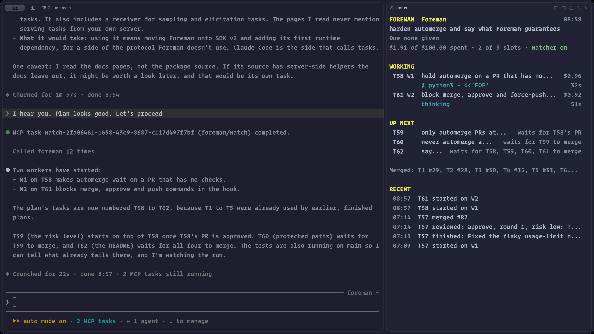
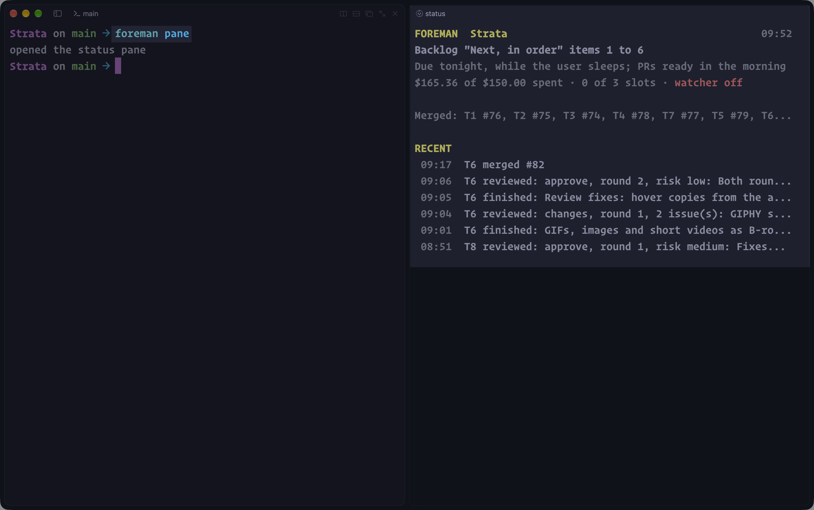

<p align="center">
    <picture>
        <source media="(prefers-color-scheme: dark)" srcset="assets/foreman-banner-dark.png">
        
    </picture>
</p>

Hand it the backlog tonight. Review the PRs in the morning.



Wake up to PRs in review order, with test steps, risk ratings and a record of what still needs you.

Foreman is a CLI and a Claude Code plugin whose orchestrator turns your backlog into a plan. It runs workers in their own git worktrees and sends their changes to a separate reviewer. You get PRs with a summary that tells you which to review first.

```text
Here's my backlog: BACKLOG.md. The deadline is tomorrow. Do it as cheaply as you can.
```

## :firecracker: The problem

Open five Claude Code sessions and you still have to review five PRs. Which one goes first? What did each worker assume? Do the changes work together? Congratulations - you've become the bottleneck.

## :sparkles: Features

### It runs while you're away

- :money_with_wings: Stops workers that exceed task or plan budgets.
- :zzz: Restarts hung workers.
- :repeat: Waits out usage limits, then resumes work.
- :hourglass_flowing_sand: Makes routine decisions when you don't answer.
- :speech_balloon: Pings you on Telegram when you choose.

### The work arrives ready to review

- :clipboard: Reviews each task and rates its risk before opening a PR.
- :camera: Captures before and after screenshots of web and macOS apps.
- :test_tube: Finds failing and flaky tests on the base branch.
- :link: Tests open PRs together for conflicts and failing tests.
- :memo: Lists PRs in review order, with test steps and assumptions.

### It stays inside your rules

- :policeman: Checks each change against your `never` list.
- :lock: Blocks edit tools outside each task's owned paths.
- :robot: Keeps planning with the orchestrator and coding with workers.
- :books: Gives workers your ADRs and accepted decisions.
- :hammer_and_wrench: Uses your skills to build, review and document work.
- :raised_hand: Leaves merging to you unless you enable automerge.

[What Foreman guarantees](#what-foreman-guarantees)

## How is this different?

| Approach | What YOU do | What Foreman does |
| --- | --- | --- |
| Several Claude Code sessions by hand | Assign the work, then review five unsorted PRs | The orchestrator plans the tasks. The summary puts their PRs in review order |
| Sharing gotchas between sessions | Copy each workaround into every tab, then remember it for the next session | A worker records a gotcha once. Foreman tells running workers and adds it to new briefs |
| Parallel sessions you supervise | Watch the tabs, notice stuck work and ask for fixes | Foreman detects hung workers. A separate reviewer sends changes back to the worker before a PR opens |
| Agent teams inside one session | Collect the agents' changes and decide what to test and merge | Each task gets its own worktree and review. Its PR includes test steps, assumptions and a risk rating |

The reviewer can send work back for two revision rounds. If it still needs changes, the orchestrator asks you how to proceed.

## How Foreman works

Workers commit to `foreman/<task>` branches in worktrees under `.foreman/worktrees/`. Foreman pushes approved task branches and opens their PRs. It also opens a separate PR to add accepted decisions to your ADR folder.

Foreman keeps its state in `.foreman/`, outside git, so it can pick up after a restart. You merge the PRs unless you turn on [automerge](#auto-merging-prs).

## What Foreman guarantees

### Enforced in code

- Worker edit tools are limited to owned paths and temp folders
- Orchestrator edit tools are limited to Foreman's state, excluding worktrees
- The reviewer is read-only and must approve before Foreman pushes or opens a task PR
- Automerge follows the [merge rules](#auto-merging-prs)
- While running, the watch task enforces budgets, restarts hung workers and handles usage limits
- Cleanup refuses unmerged or uncommitted work unless told to discard it

### Asked of the agents

- The orchestrator never writes code. Its Bash writes are not checked
- Workers stay within their brief and owned paths. Bash checks cannot catch every file a program writes, or pushes and merges hidden in scripts
- Agents follow your `never` list and ADRs. The reviewer's verdict and risk rating depend on the model's judgment
- Raising budgets, discarding work and permission to merge still need your say-so

## :package: Install

Foreman runs on macOS in Ghostty, Orca, Herdr or Rex. You need:

- Claude Code 2.1.331 or later
- [GitHub CLI](https://cli.github.com/) signed in with `gh auth login`

```sh
brew install olimorris/tap/foreman
```

To upgrade:

```sh
brew upgrade foreman
```

For web screenshots, install Playwright's Chromium with `bunx playwright install chromium`. For macOS screenshots, install Xcode and grant your terminal Screen Recording permission in System Settings > Privacy & Security > Screen & System Audio Recording.

Run `foreman doctor` to check dependencies, terminal support and screenshot setup.

### Uninstall

```sh
brew uninstall foreman
```

This removes the command and plugin. Worktrees, branches and the `.foreman/` folder remain in each repo where Foreman ran. To clean those up, run this in each repo before uninstalling:

```sh
foreman remove
```

It closes any open worker tabs, then removes every task's worktree, the `.foreman/` folder, the local `foreman/*` branches and the `.foreman/` line Foreman added to `.git/info/exclude`.

The command refuses to run while the repo's orchestrator is running or any task has unmerged commits or uncommitted files. It names the tasks with work to keep. Run `foreman remove --discard` to discard that work. Pushed branches and PRs stay on GitHub; close or delete them there.

### Working with an agent

Paste this to your coding agent, so it can answer questions about Foreman and help you set it up:

```text
Read https://raw.githubusercontent.com/olimorris/foreman/main/docs/agents.md and help me with Foreman
```

## :rocket: Usage

In your repo, start Foreman with:

```sh
foreman up
```

The orchestrator resumes its last conversation in this repo. Use `foreman up --new` to start a new one.

Give the orchestrator your backlog and deadline. It will ask about choices that change the work and writes a plan. A plan with one task per backlog item, no cuts and no open decisions can start straight away. Otherwise, it waits for your approval. `foreman help` lists the commands.

Tasks with one unmerged dependency can start on top of its approved, open PR. Set `stackTasks` to `false` if you want them to wait for the merge.

### Status

```sh
foreman status
```


### Cost

```sh
foreman budget
```


The default budget is $5 per task and $40 for the plan. While the watch task runs, Foreman stops a worker that exceeds its task budget. Exceeding the plan budget stops all running workers. The orchestrator asks you before raising either limit.

| Command | What it does |
| --- | --- |
| `foreman budget` | Shows what each task has spent against its limit |
| `foreman budget <usd>` | Sets the limit for every task |
| `foreman budget <task> <usd>` | Sets the limit for one task |
| `foreman budget --plan <usd>` | Sets the limit for the whole plan |
| `foreman budget reset` | Starts the plan's count again at $0 |
| `foreman cost` | Splits spend into workers and reviews |

The plan's spend includes its tasks and the orchestrator, counted from when you approved the plan.

On a Claude subscription, the budget tracks work at list prices rather than your subscription bill. Budget limits still apply. When the account hits its usage limit, Foreman pauses running workers and holds new tasks and reviews until the reset. It then resumes the paused workers. `foreman status` shows the reset time, or the next retry time if Foreman couldn't read it.

### Permissions

Workers run in Claude Code's auto mode. A permission refusal or prompt can still interrupt a run. The reviewer and orchestrator can also be blocked.

The orchestrator names the session, the blocked call and the permission rule to add. Use `/permissions` in that session's tab, or tell the orchestrator to skip the step. `foreman status` and the status pane show open blocks under "Needs you". A worker waiting at a permission prompt is not treated as hung.

Allowing `Bash(gh pr merge *)` cannot override Foreman's block on a worker's `gh pr merge 41` call. Use automerge or merge the PR yourself.

### Workers

```sh
foreman workers 5
```

This allows up to 5 workers for the current plan. The next plan uses `maxWorkers` from [Configuration](#gear-configuration).

Lowering the limit lets running workers finish; new tasks wait until there's room. After raising it, ask the orchestrator to start the waiting tasks. `foreman workers` on its own shows the limit and where it comes from.

### Auto-merging PRs

```sh
foreman automerge on
```

Automerge applies to the current plan. You can also tell the orchestrator "feel free to merge". Foreman merges approved task PRs when their GitHub checks allow it. Pending or failing checks hold the merge. The orchestrator sends failures back to the worker unless they also fail on the base branch.

You need to merge these PRs yourself. The orchestrator flags each one once:

- A PR with no checks, unless `automerge.allowNoChecks` is on
- A PR the reviewer rated above `automerge.maxRisk`, which is low unless you change it. It shows under "Ready to merge" in `foreman status` and the status pane
- A PR that changes a file matching `protect`. Workers can still edit those files

`foreman automerge on` lists the risk limit and any protected paths. It also tells you when `allowNoChecks` is on.

Foreman only merges its own task PRs, from `foreman/<task>` branches. Release PRs, the decisions PR and your own PRs stay with you.

The reviewer is instructed to reject a PR covered by a `never` rule about merging, such as "Merge a PR that changes a migration". Switching automerge on lists those rules.

A PR built on another task's branch waits until that task merges. Foreman uses squash merges when the repo allows them. `foreman automerge off` hands merging back to you, and `foreman status` shows when it's on.

### Summary

```sh
foreman summary
```

This writes `.foreman/summary.md` and displays it. The summary lists PRs in review order, test steps and risk ratings. It also records unfinished work, open questions and decisions Foreman made for you.

### Timeline

```sh
foreman timeline
```


The timeline shows when each task started, when its worker went quiet and which tasks waited on it.

### Status pane

```sh
foreman pane
```



A pane beside the orchestrator shows the run's status:

- **Needs you**: unanswered questions, blocked or stopped tasks, and sessions waiting for permission
- **Working**: what each worker is doing right now, and for how long
- **Ready to merge**: PRs waiting for you, with the reviewer's risk
- **Up next**: planned tasks in the order they'll start, with each task's dependencies. A short pane shows as many as fit and counts the rest
- **Recent**: the last few things that happened

A worker that goes quiet turns yellow, then red.

## :gear: Configuration

### Skills

Use skills for your coding rules, review checks and PR format. Save each skill as a `SKILL.md` file in one of these folders:

| Where to use it | File |
| --- | --- |
| Every repo | `~/.config/foreman/skills/<name>/SKILL.md` |
| This repo only | `.foreman/skills/<name>/SKILL.md` |

If both folders have a skill with the same name, Foreman uses the repo's copy. These files stay out of git.

Name a skill `pull-request` to set the PR title and description format. Use `adr` to set how decisions are written.

You can copy Foreman's [pull-request skill](.claude/skills/pull-request/SKILL.md) and edit it:

```sh
mkdir -p .foreman/skills/pull-request && curl -fsSL https://raw.githubusercontent.com/olimorris/foreman/main/.claude/skills/pull-request/SKILL.md -o .foreman/skills/pull-request/SKILL.md
```

New workers pick up skills added during a run. Each review reads your skills again.

### Settings

All settings in your repo's `.foreman/config.json` are optional. The values below are defaults, or examples where no default exists:

```json
{
  "maxWorkers": 3,
  "budget": { "perTask": 5, "plan": 40, "tasks": { "T3": 15 } },
  "orchestratorModel": "opus",
  "workerModel": "sonnet",
  "reviewerModel": "opus",
  "stackTasks": true,
  "answerMinutes": 30,
  "stallMinutes": 20,
  "test": "bun install && bun test",
  "testMinutes": 15,
  "screenshots": { "adapter": "web", "start": "npm run dev -- --port {port}", "url": "http://localhost:{port}" },
  "prScreenshots": "local",
  "never": ["Merge a release PR. I cut every release."],
  "automerge": { "allowNoChecks": false, "maxRisk": "low" },
  "protect": ["migrations/**", ".github/**"],
  "telegram": { "when": "only when a question has waited 10 minutes, or the run is finished" }
}
```

| Setting | What it does |
| --- | --- |
| `maxWorkers` | How many workers run at once. See [Workers](#workers) |
| `budget` | Spend limits in dollars: `perTask` for every task, `plan` for the whole plan and `tasks` for one task. `foreman budget` sets these for you |
| `orchestratorModel` | Orchestrator model alias or full model ID. `foreman up --model <name>` overrides it for one run. `foreman up` uses Claude Code's default when neither is set |
| `workerModel` | Model for tasks with no model in the plan. Accepts an alias like `"sonnet"` or a full model ID. Falls back to Claude Code's default |
| `reviewerModel` | Reviewer model. Falls back to Claude Code's default |
| `stackTasks` | `false` makes a task wait for its dependency to merge, instead of starting on top of its approved PR |
| `answerMinutes` | Minutes before the orchestrator can act on its stated decision for a recorded question. Defaults to 30. `0` makes it wait. Questions about money, lost work or permission to merge always wait for you |
| `stallMinutes` | Minutes without a reply or CPU activity before Foreman nudges a worker. Defaults to 20. It restarts at twice this idle time, or four times this without a reply even if commands use CPU. After two restarts, another hang goes to the orchestrator |
| `test` | Test command for the baseline and together checks. Include setup for a fresh checkout. The orchestrator works it out from the repo if it's missing |
| `testMinutes` | How long one test run can take before Foreman stops it as hung |
| `screenshots` | How to run your app for before and after screenshots |
| `prScreenshots` | `"local"` lists screenshot paths in the PR. `"branch"` pushes them to a `foreman-screenshots` branch so they show on GitHub |
| `never` | Things Foreman must never do in this repo, one plain sentence each. The orchestrator sees the list when it starts, every brief lists it and the reviewer treats a change that breaks one as an issue |
| `automerge.allowNoChecks` | `true` lets automerge merge an approved PR that has no checks, for repos with no CI. Off by default, so such a PR stays with you |
| `automerge.maxRisk` | Highest reviewer risk rating automerge accepts: `"low"`, `"medium"` or `"high"`. Defaults to `"low"`. Unknown values count as `"low"` |
| `protect` | File globs excluded from automerge, such as `migrations/**`. No default. Workers can edit them, but you merge those PRs |
| `telegram` | Enables pings through Claude Code's Telegram plugin after you install and pair it. `when` tells the orchestrator when to ping you. Without `when`, it pings for questions and a finished run. See [setup instructions](docs/agents.md) |

For a macOS app, `screenshots` builds the app instead of starting a server:

```json
{ "screenshots": { "adapter": "macos", "build": "xcodebuild -scheme App -derivedDataPath {derivedData} build", "app": "{derivedData}/Build/Products/Debug/App.app" } }
```
