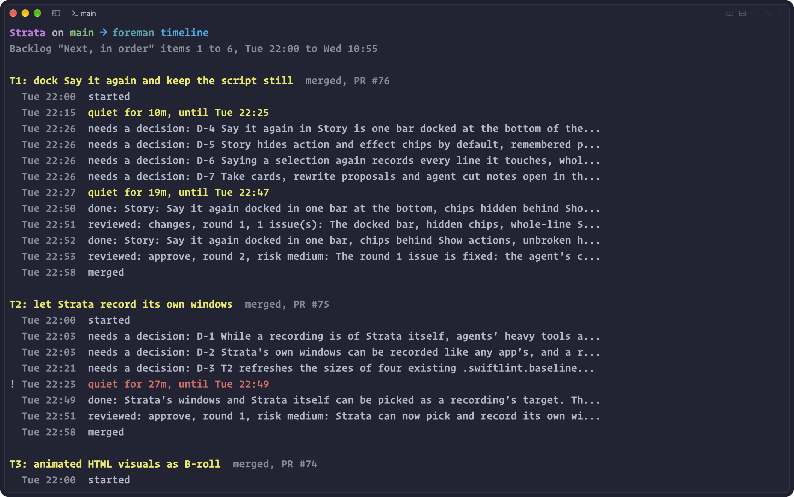

<p align="center">
    <picture>
        <source media="(prefers-color-scheme: dark)" srcset="assets/foreman-banner-dark.png">
        
    </picture>
</p>

## :firecracker: Problem Statement

Building and deploying software takes a team of engineers. Those engineers need a manager to coordinate and review their work. That manager needs a leader to set the vision. That leader is you.

Foreman gives you the team and the manager, right inside Claude Code.

## :sparkles: Features

- :wrestling: Runs a crew of Claude workers in parallel, each in its own worktree and tab
- :calendar: Turns a backlog of any format into a plan to build
- :mag: Reviews every task against your intent before it becomes a PR
- :camera: Takes before and after screenshots of web and macOS apps
- :moneybag: Caps spend per task and per plan
- :robot: Runs simple tasks on cheaper models
- :rotating_light: Spots hung workers and restarts them
- :memo: Warns every worker about known problems, like flaky tests
- :zzz: Keeps working while you're away, and logs every call it makes
- :clipboard: Writes a summary of the PRs to review, in order

> [!IMPORTANT]
> Foreman currently runs inside [Rex](https://www.superlogical.com), a terminal app. Each worker gets its own Rex tab, so you can watch any of them or step in.

## :construction_worker: What is Foreman?

Foreman is a Claude Code plugin that turns one Claude session into the manager of a small engineering team:

- **The engineers** are worker Claude sessions, numbered W1, W2 and so on. Each gets its own git worktree and Rex tab, so they work in parallel without stepping on each other.
- **The manager** is Foreman. It never writes code. It plans, hands out work, keeps everyone aligned and checks the work before it reaches you.
- **The leader** is you. You set the direction and approve every PR. Nothing merges without your say-so.

### How it works

<p align="center">
    <picture>
        <source media="(prefers-color-scheme: dark)" srcset="assets/how-it-works-dark.svg">
        
    </picture>
</p>

1. **Give it a backlog.** Foreman talks it through with you, then turns each item into a brief with clear boundaries.
2. **It schedules the crew.** Foreman decides what runs in parallel and what goes first, based on dependencies and your deadline.
3. **Decisions are shared.** Workers propose decisions, Foreman accepts them and tells the rest of the crew, so conflicts surface before merge time.
4. **Work gets reviewed.** A separate reviewer checks each change against your intent, with screenshots for UI work, and sends it back until it's right.
5. **You approve the PR.** Each PR says what was asked, which decisions it touched, what changed on screen and how risky it is. Merging it starts the tasks that were waiting on it.

### What Foreman isn't

It's Claude Code only and works on one repo at a time. That's deliberate - fewer moving parts, less to break.

## :package: Install

Foreman runs on macOS inside [Rex](https://www.superlogical.com). You need:

- Claude Code 2.1.224 or later
- [Bun](https://bun.sh), `git`, `jq`, `fswatch` and `gh` (signed in with `gh auth login`)
- For web screenshots: Playwright's Chromium (`bunx playwright install chromium`)
- For macOS app screenshots: Xcode, and Screen Recording permission for your terminal in System Settings > Privacy & Security > Screen & System Audio Recording

```sh
brew install jq fswatch gh
git clone https://github.com/olimorris/foreman ~/Code/Foreman
cd ~/Code/Foreman && bun install
ln -s ~/Code/Foreman/bin/foreman ~/.local/bin/foreman
foreman doctor
```

`foreman doctor` checks every requirement and says what's missing.

## :rocket: Usage

Open Rex in your repo and start Foreman:

```sh
foreman up
```

Then tell it what you want done:

```text
Here's my backlog: BACKLOG.md. The deadline is tomorrow. Do it as cheaply as you can.
```

Foreman asks about anything unclear, then shows you a plan to approve. Workers open in their own tabs, and approved work arrives as PRs for you to merge. When the run ends, Foreman writes a summary of what to review.

### What each task is doing


```sh
foreman status
```

### What it's cost so far


```sh
foreman budget
```

Each task has a $5 limit and the plan has $40. When a task goes over, Foreman stops its worker and asks whether to raise the limit.

### The PRs to review


```sh
foreman summary
```

The PRs in the order to review them, how to test each one, and the assumptions to check.

### How the run went



```sh
foreman timeline
```

When each task started, when its worker went quiet, and which tasks waited on it.

Run `foreman help` to see every command. Foreman keeps its state in `.foreman/` in your repo, out of git, and picks up from there if the orchestrator restarts.

### Status pane


```sh
foreman pane
```

`foreman up` opens a status pane beside the orchestrator, so you can see the run at a glance:

- **Needs you**: questions waiting on you, and tasks that are blocked or stopped
- **Working**: what each worker is doing right now, and for how long
- **Ready to merge**: PRs waiting for you, with the reviewer's risk
- **Waiting**: planned tasks and what they wait on
- **Recent**: the last few things that happened

A worker that goes quiet turns yellow, then red. Run `foreman pane` if you close it.

## :gear: Settings

Settings live in `.foreman/config.json` in your repo, and every one is optional. Here they are with their defaults, or an example where there's no default:

```json
{
  "maxWorkers": 3,
  "budget": { "perTask": 5, "plan": 40, "tasks": { "T3": 15 } },
  "workerModel": "sonnet",
  "reviewerModel": "opus",
  "stackTasks": true,
  "answerMinutes": 30,
  "stallMinutes": 20,
  "test": "bun install && bun test",
  "testMinutes": 15,
  "screenshots": { "adapter": "web", "start": "npm run dev -- --port {port}", "url": "http://localhost:{port}" },
  "prScreenshots": "local"
}
```

| Setting | What it does |
| --- | --- |
| `maxWorkers` | How many workers run at once |
| `budget` | Spend limits in dollars: `perTask` for every task, `plan` for the whole plan and `tasks` for one task. `foreman budget` sets these for you |
| `workerModel` | The model for tasks the plan doesn't give one, as an alias like `"sonnet"` or a full model id. Without it, workers use Claude Code's default |
| `reviewerModel` | The model the reviewer runs on. Without it, the reviewer uses Claude Code's default |
| `stackTasks` | `false` makes a task wait for its dependency to merge, instead of starting on top of its approved PR |
| `answerMinutes` | How long Foreman waits for your answer before it makes its own call. `0` makes it always wait |
| `stallMinutes` | How long a worker can go without replying, with no CPU use, before Foreman nudges it. It restarts the worker at twice this |
| `test` | The command that runs your tests in a fresh checkout, so include any setup. Foreman works it out if it's missing |
| `testMinutes` | How long one test run can take before Foreman stops it as hung |
| `screenshots` | How to run your app for before and after screenshots |
| `prScreenshots` | `"local"` lists screenshot paths in the PR. `"branch"` pushes them to a `foreman-screenshots` branch so they show on GitHub |

For a macOS app, `screenshots` builds the app instead of starting a server:

```json
{ "screenshots": { "adapter": "macos", "build": "xcodebuild -scheme App -derivedDataPath {derivedData} build", "app": "{derivedData}/Build/Products/Debug/App.app" } }
```

## :sos: Help

Paste this to your coding agent, so it can answer questions about Foreman and help you set it up:

```text
Read https://raw.githubusercontent.com/olimorris/foreman/main/docs/agents.txt and help me with Foreman.
```
