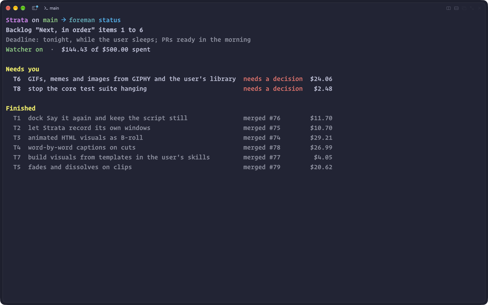

<p align="center">
    <picture>
        <source media="(prefers-color-scheme: dark)" srcset="assets/foreman-banner-dark.png">
        
    </picture>
</p>

## :sparkles: Features

- :robot: Spin up multiple Claude Code agents in parallel, reporting to the Foreman orchestrator
- :zap: Blazingly fast, because each worker runs in its own worktree and tab
- :policeman: Keeps every worker to your rules and puts you in ultimate control
- :money_with_wings: Runs simple tasks on cheaper models
- :zzz: Keeps working while you're away, and logs every call it makes
- :books: Reads your repo's ADRs and keeps every worker to them
- :camera: Takes before and after screenshots of web and macOS apps
- :link: Tests the open PRs merged together, to catch ones that pass alone but break together
- :memo: Runs your tests on the base branch first, and warns every worker about what already fails
- :hammer_and_wrench: Builds, reviews and opens PRs by your own skills
- :clipboard: Writes a summary of the PRs to review, in order

## :firecracker: The problem

You've got a backlog and a deadline. One Claude Code session processes one task at a time, and every task waits on you to review the last.

_Sure_, you could open five Claude Code sessions. But, then you're the one splitting up and assigning the work. Trying to ensure each session keeps out of the way of the other. Sharing "gotchas" and decisions between sessions. Checking every result and untangling the merge conflicts. **Congratulations - you've become the bottleneck**.

Foreman brings in the team and the manager to run it. You bring the direction and the control.

## :construction_worker: What is Foreman?

Foreman is a CLI and a Claude Code plugin. `foreman up` starts Claude Code with the plugin loaded, and that session runs the team:

- **The engineers** are worker sessions, numbered W1, W2 and so on. Each gets its own git worktree and tab, so they work in parallel without stepping on each other
- **The manager** is the orchestrator. It never writes code. It plans, hands out work, keeps everyone aligned and checks the work before it reaches you
- **The leader** is you. You set the direction and approve every PR

### How it works

<p align="center">
    <picture>
        <source media="(prefers-color-scheme: dark)" srcset="assets/how-it-works-dark.svg">
        
    </picture>
</p>

1. **Give it a backlog.** Foreman talks it through with you, then turns each item into a brief with clear boundaries and finished criteria
2. **It schedules the crew.** Foreman decides what work runs in parallel and what goes first, based on dependencies and your deadline
3. **Decisions are shared.** Workers propose decisions. Foreman accepts them and tells the rest of the crew, so conflicts surface before merge time
4. **Work gets reviewed.** A separate reviewer task checks each change against your intent, with screenshots for UI work, and sends it back to the workers until it's right
5. **You approve the PR.** Each PR says what was asked, which decisions it touched, what changed on screen and how risky it is. Tasks that build on it start without waiting for the merge

### What it touches

- Workers run in Claude Code's auto mode, each in a worktree under `.foreman/worktrees/`, and commit to their own `foreman/<task>` branch
- The reviewer task can only read files
- The orchestrator and workers talk to Foreman through its MCP server, which never runs in your Claude Code sessions
- Foreman pushes each approved task's branch and opens its PR
- Foreman also makes PRs that adds accepted decisions to your ADR folder
- Foreman never merges unless you turn on [automerge](#auto-merging-prs) and merges its own PRs
- It keeps its state in `.foreman/`, out of git, and picks up from there after a restart

### Why not Claude Code's agent teams?

Agent teams are great for research and review inside one session. Foreman is built for unattended builds that end in PRs, so it needs things teams doesn't offer:

- Each worker gets its own worktree, so workers never share a checkout
- Every task has its own budget, and a hung worker is spotted and restarted

## :package: Install

```sh
brew install olimorris/tap/foreman
```

and upgrade with:

```sh
brew upgrade foreman
```

Foreman runs on macOS inside a terminal app. You also need:

- Claude Code 2.1.332 or later
- [GitHub CLI](https://cli.github.com/) signed in with `gh auth login`
- For web screenshots: Playwright's Chromium (`bunx playwright install chromium`)
- For macOS screenshots: Xcode, and Screen Recording permission for your terminal in System Settings > Privacy & Security > Screen & System Audio Recording

`foreman doctor` checks that all dependencies are installed and can be accessed.

### Uninstall

```sh
brew uninstall foreman
```

To remove the command and the plugin. Foreman also leaves worktrees, branches and its `.foreman/` folder in each repo it ran in. Before you uninstall, run this in each of those repos:

```sh
foreman remove
```

It closes any worker tabs still open, then removes every task's worktree, the `.foreman/` folder, the local `foreman/*` branches and the `.foreman/` line Foreman added to `.git/info/exclude`. It won't run while the orchestrator is running for the repo. It also won't run while a task has unmerged commits or uncommitted files, and it names those tasks. Run `foreman remove --discard` to lose that work. Branches Foreman pushed and its PRs stay on GitHub, so close or delete those there.

### Working with an agent

Paste this to your coding agent, so it can answer questions about Foreman and help you set it up:

```text
Read https://raw.githubusercontent.com/olimorris/foreman/main/docs/agents.txt and help me with Foreman.
```

## :rocket: Usage

In your repo, start Foreman with:

```sh
foreman up
```

If you've run it in this repo before, the orchestrator carries on its last conversation, so you can exit and come back without losing it. `foreman up --new` starts a new conversation instead.

Then tell it what you want done:

```text
Here's my backlog: BACKLOG.md. The deadline is tomorrow. Do it as cheaply as you can.
```

Foreman asks about anything unclear, then plans the work. If the plan differs from your backlog, such as splitting or cutting an item, it waits for your approval. If you don't answer within 30 minutes, Foreman makes the call and notes it in the summary. Workers open in their own tabs, and approved work arrives as PRs. `foreman help` lists the commands for you. The orchestrator and workers use Foreman's MCP tools instead.

The orchestrator waits on long-running work as [MCP tasks](https://modelcontextprotocol.io/extensions/tasks/overview), so you no longer see a message from another session each time it wakes. Its tab shows "MCP task still running" while it waits, and "MCP task ... completed" when something needs it.

### Status

```sh
foreman status
```



### Cost

```sh
foreman budget
```


By default, each task can spend $5 and the plan $40. Change these in [Settings](#gear-settings). When a task goes over, Foreman stops its worker and asks whether to raise the limit.

On a Pro, Max or other Claude subscription, these amounts measure work done at list prices, not what you pay. Your usage limit is what stops work. When you hit it, Foreman pauses every worker, starts nothing new and holds reviews until the limit resets. Then it picks each worker up where it left off. `foreman status` shows when the limit resets.

### Permissions

Workers run in auto mode by default, so Claude Code _may_ refuse a call or wait at a permission prompt in a worker's tab. The same can happen to the reviewer and the orchestrator. The orchestrator tells you in one line, like:

> _"W2 on T5 was blocked from running `gh pr merge 41` by auto mode. To allow it, add `Bash(gh pr merge *)` in /permissions in that worker's tab, or tell me to skip it."_

`foreman status` and the status pane list the task under "Needs you". Once you allow or skip it, the orchestrator tells the worker and the task moves back. A worker waiting at a prompt is never treated as hung, and answering the prompt in its tab clears it.

### Workers

```sh
foreman workers 5
```

Runs up to 5 workers at once until the current plan finishes. The next plan goes back to `maxWorkers` from [Settings](#gear-settings). Lowering it never stops a running worker, and new tasks wait until fewer are running. After raising it, ask the orchestrator to start the tasks that were waiting. `foreman workers` on its own shows the limit and where it comes from.

### Auto-merging PRs

```sh
foreman automerge on
```

Foreman merges each task's PR itself once the reviewer approves it and every check passes on GitHub. A PR with no checks merges once it's approved. When a check fails, Foreman doesn't merge and sends the worker to fix it. You can also tell the orchestrator _"feel free to merge"_.

Foreman only merges its own task PRs, from `foreman/<task>` branches. Release PRs, the decisions PR and your own PRs stay with you. Your `never` list still applies. The reviewer won't approve a PR that a rule about merging covers, such as "Merge a PR that changes a migration", and switching automerge on lists those rules. A PR built on another task's branch waits until that task merges. Merges use squash when the repo allows it. `foreman automerge off` hands merging back to you, and `foreman status` shows when it's on.

### Summary

```sh
foreman summary
```


What got done, the order to review the PRs in and how to test each one, what didn't get finished, and the calls Foreman made for you.

### Timeline

```sh
foreman timeline
```


When each task started, when its worker went quiet, and which tasks waited on it.

### Status pane

```sh
foreman pane
```


A status pane beside the orchestrator shows the run at a glance:

- **Needs you**: questions waiting on you, tasks that are blocked or stopped, and sessions a permission has blocked
- **Working**: what each worker is doing right now, and for how long
- **Ready to merge**: PRs waiting for you, with the reviewer's risk
- **Waiting**: planned tasks and what they wait on
- **Recent**: the last few things that happened

A worker that goes quiet turns yellow, then red.

## :gear: Settings

Settings live in `.foreman/config.json` in your repo, and every one is optional. Here they are with their defaults, or an example where there's no default:

```json
{
  "maxWorkers": 3,
  "budget": { "perTask": 5, "plan": 40, "tasks": { "T3": 15 } },
  "orchestratorModel": "opus",
  "workerModel": "sonnet",
  "reviewerModel": "opus",
  "stackTasks": true,
  "answerMinutes": 30,
  "stallMinutes": 20,
  "test": "bun install && bun test",
  "testMinutes": 15,
  "screenshots": { "adapter": "web", "start": "npm run dev -- --port {port}", "url": "http://localhost:{port}" },
  "prScreenshots": "local",
  "never": ["Merge a release PR. I cut every release."],
  "telegram": { "when": "only when a question has waited 10 minutes, or the run is finished" }
}
```

| Setting | What it does |
| --- | --- |
| `maxWorkers` | How many workers run at once. See [Workers](#workers) |
| `budget` | Spend limits in dollars: `perTask` for every task, `plan` for the whole plan and `tasks` for one task. `foreman budget` sets these for you |
| `orchestratorModel` | The model `foreman up` starts the orchestrator on, as an alias or a full model id. `foreman up --model <name>` overrides it for one run. Without it, the orchestrator uses Claude Code's default |
| `workerModel` | The model for tasks the plan doesn't give one, as an alias like `"sonnet"` or a full model id. Without it, workers use Claude Code's default |
| `reviewerModel` | The model the reviewer runs on. Without it, the reviewer uses Claude Code's default |
| `stackTasks` | `false` makes a task wait for its dependency to merge, instead of starting on top of its approved PR |
| `answerMinutes` | How long Foreman waits for your answer before it makes its own call. `0` makes it always wait |
| `stallMinutes` | How long a worker can go without replying, with no CPU use, before Foreman nudges it. It restarts the worker at twice this |
| `test` | The command that runs your tests in a fresh checkout, so include any setup. Foreman works it out if it's missing |
| `testMinutes` | How long one test run can take before Foreman stops it as hung |
| `screenshots` | How to run your app for before and after screenshots |
| `prScreenshots` | `"local"` lists screenshot paths in the PR. `"branch"` pushes them to a `foreman-screenshots` branch so they show on GitHub |
| `never` | Things Foreman must never do in this repo, one plain sentence each. The orchestrator sees the list when it starts, every brief lists it and the reviewer treats a change that breaks one as an issue |
| `telegram` | Turns on pings through Claude Code's Telegram plugin. `when` says in your own words when the orchestrator should ping you. [docs/agents.txt](docs/agents.txt) covers setting up the plugin |

For a macOS app, `screenshots` builds the app instead of starting a server:

```json
{ "screenshots": { "adapter": "macos", "build": "xcodebuild -scheme App -derivedDataPath {derivedData} build", "app": "{derivedData}/Build/Products/Debug/App.app" } }
```

### Your own skills

Put your skills in `.foreman/skills/<name>/SKILL.md`. Every session gets them, and they stay out of git.

- Workers and the orchestrator load them as `user-skills:<name>`
- The reviewer checks each change against your review skills
- A `pull-request` skill shapes the PRs Foreman opens
- An `adr` skill shapes the decisions it records

As an example, you can start from Foreman's own [pull-request skill](.claude/skills/pull-request/SKILL.md):

```sh
mkdir -p .foreman/skills/pull-request && curl -fsSL https://raw.githubusercontent.com/olimorris/foreman/main/.claude/skills/pull-request/SKILL.md -o .foreman/skills/pull-request/SKILL.md
```

A skill you add mid-run reaches workers started after it.
