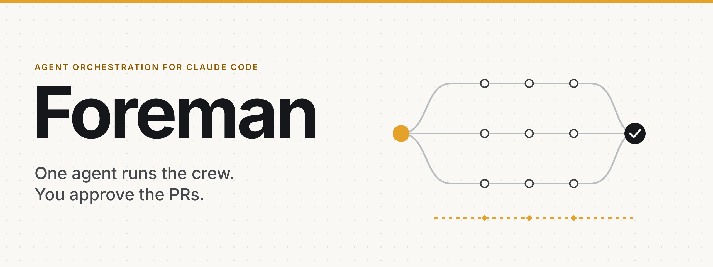

<p align="center">
    <picture>
        <source media="(prefers-color-scheme: dark)" srcset="assets/foreman-banner-dark.png">
        
    </picture>
</p>

## :sparkles: Features

- :robot: Run Claude Code agents in parallel, as part of a team, reporting to the Foreman
- :camera: Takes before and after screenshots of web and macOS apps
- :books: Reads your repo's ADRs and keeps every worker to them
- :link: Tests the open PRs merged together, to catch ones that pass alone but break together
- :robot: Runs simple tasks on cheaper models
- :memo: Runs your tests on the base branch first, and warns every worker about what already fails
- :zzz: Keeps working while you're away, and logs every call it makes
- :iphone: Pings you on Telegram, and takes your answers from there
- :clipboard: Writes a summary of the PRs to review, in order

## :firecracker: The problem

You've got a backlog and a deadline. One Claude Code session works through it one task at a time, and every task waits on you to review the last.

You could open five sessions yourself. Then you're the one splitting up the work, keeping sessions out of each other's way, checking every result and untangling the merge conflicts. You've become the bottleneck.

Foreman brings in a team, and a manager to run it. You set the direction and approve the PRs.

## :construction_worker: What is Foreman?

Foreman is a CLI and a Claude Code plugin. `foreman up` starts Claude Code with the plugin loaded, and that session runs the team:

- **The engineers** are worker sessions, numbered W1, W2 and so on. Each gets its own git worktree and tab, so they work in parallel without stepping on each other
- **The manager** is the orchestrator. It never writes code. It plans, hands out work, keeps everyone aligned and checks the work before it reaches you
- **The leader** is you. You set the direction and approve every PR

You drive Foreman with the `foreman` CLI. The orchestrator and workers drive it through Foreman's MCP server instead. See [The CLI and the MCP server](#electric_plug-the-cli-and-the-mcp-server).

### How it works

<p align="center">
    <picture>
        <source media="(prefers-color-scheme: dark)" srcset="assets/how-it-works-dark.svg">
        
    </picture>
</p>

1. **Give it a backlog.** Foreman talks it through with you, then turns each item into a brief with clear boundaries
2. **It schedules the crew.** Foreman decides what runs in parallel and what goes first, based on dependencies and your deadline
3. **Decisions are shared.** Workers propose decisions. Foreman accepts them and tells the crew, so conflicts surface before merge time
4. **Work gets reviewed.** A separate reviewer checks each change against your intent, with screenshots for UI work, and sends it back until it's right
5. **You approve the PR.** Each PR says what was asked, which decisions it touched, what changed on screen and how risky it is. Tasks that build on it start without waiting for the merge

### What it touches

- Workers run in Claude Code's auto mode, each in a worktree under `.foreman/worktrees/`, and commit to their own `foreman/<task>` branch
- The reviewer can only read files
- Foreman's MCP server runs only in the orchestrator and worker sessions Foreman starts, never in your own Claude Code sessions
- Foreman pushes each approved task's branch and opens its PR, plus a PR that adds accepted decisions to your ADR folder
- Foreman never merges unless you turn on [automerge](#let-foreman-merge), and then only its own task PRs
- It keeps its state in `.foreman/`, out of git, and picks up from there after a restart

### Why not Claude Code's agent teams?

Agent teams are great for research and review inside one session. Foreman is built for unattended builds that end in PRs, so it needs things teams don't offer:

- Each worker gets its own worktree, so workers never share a checkout
- Every task has its own budget, and a hung worker is spotted and restarted

## :package: Install

```sh
brew install olimorris/tap/foreman
```

This installs the `foreman` command along with [Bun](https://bun.sh), `jq`, `fswatch` and `gh`. `foreman up` loads the Claude Code plugin from the same install, so the command and the plugin are always the same version. `brew upgrade foreman` updates both, and sessions that are already running keep working.

Foreman runs on macOS inside a terminal app it can drive. It detects which one you're in, so you only need `FOREMAN_TERMINAL=<name>` to override that and pick another from `src/integrations/`. [Rex](https://www.superlogical.com) is the default when it can't tell. You also need:

- Claude Code 2.1.224 or later (`brew install --cask claude-code`)
- `gh` signed in with `gh auth login`
- For web screenshots: Playwright's Chromium (`bunx playwright install chromium`)
- For macOS app screenshots: Xcode, and Screen Recording permission for your terminal in System Settings > Privacy & Security > Screen & System Audio Recording

`foreman doctor` checks that all dependencies are installed and can be accessed.

### Uninstall

`brew uninstall foreman` removes the command and the plugin, but not what Foreman made in your repos.

For every repo it ran in:

```sh
git worktree remove --force .foreman/worktrees/<task>   # once per leftover worktree
rm -rf .foreman
git worktree prune                                       # if you deleted .foreman/ first
git branch -D $(git branch --list 'foreman/*' | tr -d ' *+')
```

Then delete the `.foreman/` line from `.git/info/exclude`. Foreman added it so `.foreman/` stays out of git. Its PRs and any branches it pushed are on GitHub, so close or delete those there.

### Working with an agent

Paste this to your coding agent, so it can answer questions about Foreman and help you set it up:

```text
Read https://raw.githubusercontent.com/olimorris/foreman/main/docs/agents.txt and help me with Foreman.
```

## :rocket: Usage

In your repo, start Foreman:

```sh
foreman up
```

Then tell it what you want done:

```text
Here's my backlog: BACKLOG.md. The deadline is tomorrow. Do it as cheaply as you can.
```

Foreman asks about anything unclear, then plans the work. If the plan differs from your backlog, such as splitting or cutting an item, it waits for your approval. If you don't answer within 30 minutes, Foreman makes the call and notes it in the summary. Workers open in their own tabs, and approved work arrives as PRs. `foreman help` lists every command.

### Status

```sh
foreman status
```


### Cost

```sh
foreman budget
```


By default, each task can spend $5 and the overall plan, $40. This can be changed in [Settings](#gear-settings). When a task goes over, Foreman stops its worker and asks whether to raise the limit.

On the Pro, Max or other Claude subscription, these dollar amounts measure how much work was done at list prices, not what you paid. Your subscription's usage limit stops work. When reached, Foreman pauses every worker, ensuring no new work is undertaken and holds reviews until the limit resets. The foreman then picks each worker up where it left off. `foreman status` shows the wait and when the limit resets.

### Permissions

Workers run in auto mode by default, so Claude Code _may_ refuse a call or wait at a permission prompt in a worker's tab. The same can happen to the reviewer and the orchestrator. The orchestrator tells you in one line, like:

> _"W2 on T5 was blocked from running `gh pr merge 41` by auto mode. To allow it, add `Bash(gh pr merge *)` in /permissions in that worker's tab, or tell me to skip it."_

These events are shown as _"Needs you" via `foreman status` or the status pane. Once allowed or skipped, the orchestrator informs the worker and the task moves back. A worker waiting at this prompt stage is never treated as hung, and therefore will never be cleared.

### Workers

```sh
foreman workers 5
```

Runs up to 5 workers at once until the current plan finishes. The next plan goes back to `maxWorkers` from [Settings](#gear-settings). Lowering it will never stop a running worker, and new tasks wait until fewer are running. After raising it, run `foreman next`, or ask the orchestrator, to start the tasks that were waiting. `foreman workers` on its own shows the limit and where it comes from.

### Auto-merging PRs

```sh
foreman automerge on
```

Foreman merges each task's PR itself once the reviewer approves it and every check passes in GitHub. A PR with zero checks, merges once it's approved. When a check fails, Foreman doesn't merge and sends the worker to fix it. You can also tell the orchestrator _"feel free to merge"_.

Foreman only merges its own task PRs, from `foreman/<task>` branches. Release PRs, the decisions PR and your own PRs stay with you. Your `never` list still applies. The reviewer won't approve a PR that a rule about merging covers, such as "Merge a PR that changes a migration", and switching automerge on lists those rules. A PR built on another task's branch waits until that task merges. Merges use squash when the repo allows it. `foreman automerge off` hands merging back to you, and `foreman status` shows when it's on.

### Summary

```sh
foreman summary
```


What got done, the order to review the PRs in and how to test each one, what didn't get finished, and the calls Foreman made for you.

### Timeline

```sh
foreman timeline
```


When each task started, when its worker went quiet, and which tasks waited on it.

### Status pane

```sh
foreman pane
```


A status pane beside the orchestrator shows the run at a glance:

- **Needs you**: questions waiting on you, tasks that are blocked or stopped, and sessions a permission has blocked
- **Working**: what each worker is doing right now, and for how long
- **Ready to merge**: PRs waiting for you, with the reviewer's risk
- **Waiting**: planned tasks and what they wait on
- **Recent**: the last few things that happened

A worker that goes quiet turns yellow, then red.

## :electric_plug: The CLI and the MCP server

Foreman starts an MCP server for each worker when it starts, resumes or restarts. The plugin doesn't declare the server itself, so it never starts in your own Claude Code sessions or in the reviewer.

### The tools each session gets

| Session | Tools |
| --- | --- |
| Worker | `report`, `propose`, `note` and `tidy` |
| Orchestrator | Everything it needs to run the plan, like `plan`, `next`, `spawn`, `send`, `review`, `deliver`, `accept` and `ask`. Also `status`, `timeline`, `summary`, `cost` and `budget` to check on the run, and `watch`, `baseline` and `together`, which run as MCP tasks |
| Reviewer | None. It can only read files |

Workers can't run `foreman` commands any more. Each worker starts with the `foreman` command denied in its Bash tool, so a worker that tries is refused.

The commands you and the orchestrator both use, like `status`, `timeline`, `summary`, `cost` and `budget`, share one implementation. `foreman status` in your terminal and the orchestrator's `status` tool give the same answer.

### What you see while the orchestrator waits

Three of the orchestrator's tools can take a long time. `watch` waits until something in the run needs the orchestrator, `baseline` runs your tests on the base branch and `together` tests the open PRs merged together. Each one returns straight away as an MCP task, so the orchestrator ends its turn and spends nothing while it waits.

In the orchestrator's tab:

- While a task runs, "1 MCP task still running" shows next to the turn's time. `/tasks` lists the running tasks.
- When a task completes, a line like `⏺ MCP task watch-… (foreman/watch) completed.` appears, and the orchestrator wakes up and acts on what the task found. That's Foreman waking it, not you or another session.

After handling each line from the watcher, the orchestrator calls `watch` again. If it tries to end a turn while tasks are in flight and no watch task is running, a Stop hook sends it back to call `watch`.

The server stops when the orchestrator's session exits, so its tasks don't survive a restart. After a restart, the orchestrator picks up the run from `.foreman/` and calls `watch` again. A baseline or together check that was running when it stopped is lost, so ask for it again if you need it.

## :gear: Settings

Settings live in `.foreman/config.json` in your repo, and every one is optional. Here they are with their defaults, or an example where there's no default:

```json
{
  "maxWorkers": 3,
  "budget": { "perTask": 5, "plan": 40, "tasks": { "T3": 15 } },
  "orchestratorModel": "opus",
  "workerModel": "sonnet",
  "reviewerModel": "opus",
  "stackTasks": true,
  "answerMinutes": 30,
  "stallMinutes": 20,
  "test": "bun install && bun test",
  "testMinutes": 15,
  "screenshots": { "adapter": "web", "start": "npm run dev -- --port {port}", "url": "http://localhost:{port}" },
  "prScreenshots": "local",
  "never": ["Merge a release PR. I cut every release."],
  "telegram": { "when": "only when a question has waited 10 minutes, or the run is finished" }
}
```

| Setting | What it does |
| --- | --- |
| `maxWorkers` | How many workers run at once. See [More or fewer workers](#more-or-fewer-workers) |
| `budget` | Spend limits in dollars: `perTask` for every task, `plan` for the whole plan and `tasks` for one task. `foreman budget` sets these for you |
| `orchestratorModel` | The model `foreman up` starts the orchestrator on, as an alias or a full model id. `foreman up --model <name>` overrides it for one run. Without it, the orchestrator uses Claude Code's default |
| `workerModel` | The model for tasks the plan doesn't give one, as an alias like `"sonnet"` or a full model id. Without it, workers use Claude Code's default |
| `reviewerModel` | The model the reviewer runs on. Without it, the reviewer uses Claude Code's default |
| `stackTasks` | `false` makes a task wait for its dependency to merge, instead of starting on top of its approved PR |
| `answerMinutes` | How long Foreman waits for your answer before it makes its own call. `0` makes it always wait |
| `stallMinutes` | How long a worker can go without replying, with no CPU use, before Foreman nudges it. It restarts the worker at twice this |
| `test` | The command that runs your tests in a fresh checkout, so include any setup. Foreman works it out if it's missing |
| `testMinutes` | How long one test run can take before Foreman stops it as hung |
| `screenshots` | How to run your app for before and after screenshots |
| `prScreenshots` | `"local"` lists screenshot paths in the PR. `"branch"` pushes them to a `foreman-screenshots` branch so they show on GitHub |
| `never` | Things Foreman must never do in this repo, one plain sentence each. The orchestrator sees the list when it starts, every brief lists it and the reviewer treats a change that breaks one as an issue |
| `telegram` | Turns on pings through Claude Code's Telegram plugin. `when` says in your own words when the orchestrator should ping you. See [Pings on Telegram](#pings-on-telegram) |

For a macOS app, `screenshots` builds the app instead of starting a server:

```json
{ "screenshots": { "adapter": "macos", "build": "xcodebuild -scheme App -derivedDataPath {derivedData} build", "app": "{derivedData}/Build/Products/Debug/App.app" } }
```

### Your own skills

Foreman follows your own skills when it builds, reviews and opens PRs. Put each one in `.foreman/skills/<name>/SKILL.md`, in [Claude Code's skill format](https://code.claude.com/docs/en/skills): frontmatter with a `name` and a `description`, then the instructions. They stay on your machine, since Foreman keeps `.foreman/` out of git.

- The orchestrator and every worker load them as `user-skills:<name>`, like any other skill, so workers build by them. Foreman starts each session with a second plugin folder, `.foreman/skills-plugin`, that links back to `.foreman/skills`, so your skills never land in a worktree a worker commits from. The MCP server doesn't serve them, because Team and Enterprise logins ignore an MCP server's skills unless an admin turns them on, while a plugin folder works on every plan.
- The reviewer reads every skill and checks each change against the ones whose description fits reviewing code, like a code-review skill. Breaking one sends the change back to its worker, with the skill named.
- A skill named `pull-request` shapes the PRs Foreman opens. The reviewer writes the title and description by it, and Foreman adds the intent, assumptions, decisions, screenshots, verdict and risk below. A title that isn't a conventional commit is dropped for the task's own title.
- A skill named `adr` shapes the decisions Foreman records. The orchestrator writes each one in its format, and in a repo with no ADR folder yet, the new folder takes the skill's title line, status and a README that describes them. An existing ADR folder keeps its own convention.

Foreman names each skill by its folder, so a skill copied in as `.foreman/skills/adr/` is the `adr` skill whatever its frontmatter says. Foreman's own [pull-request skill](.claude/skills/pull-request/SKILL.md) is a working example. Download it and make it yours:

```sh
mkdir -p .foreman/skills/pull-request && curl -fsSL https://raw.githubusercontent.com/olimorris/foreman/main/.claude/skills/pull-request/SKILL.md -o .foreman/skills/pull-request/SKILL.md
```

The reviewer reads your skills at every review. The orchestrator and workers load them when their session starts, so a skill you add mid-run reaches the workers started or restarted after it. Without `.foreman/skills/`, everything works as before.
