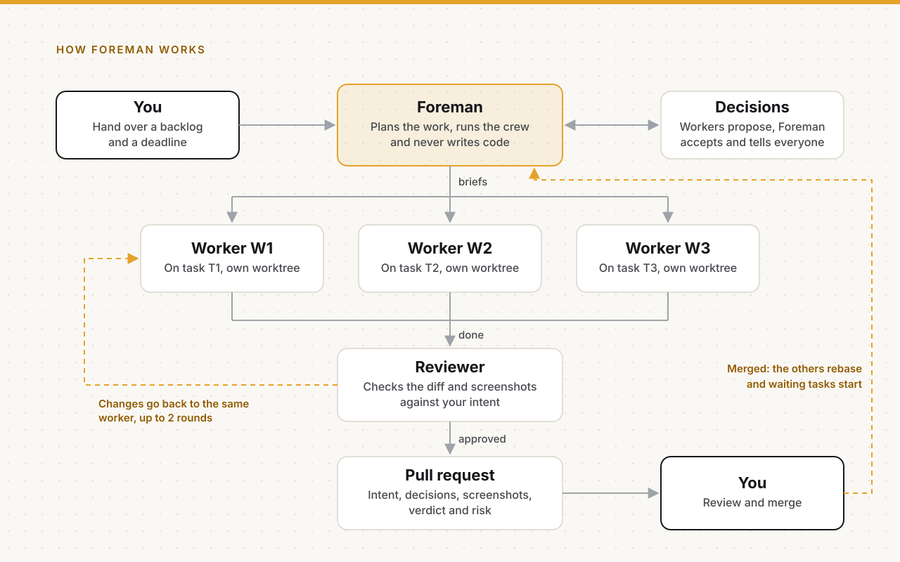
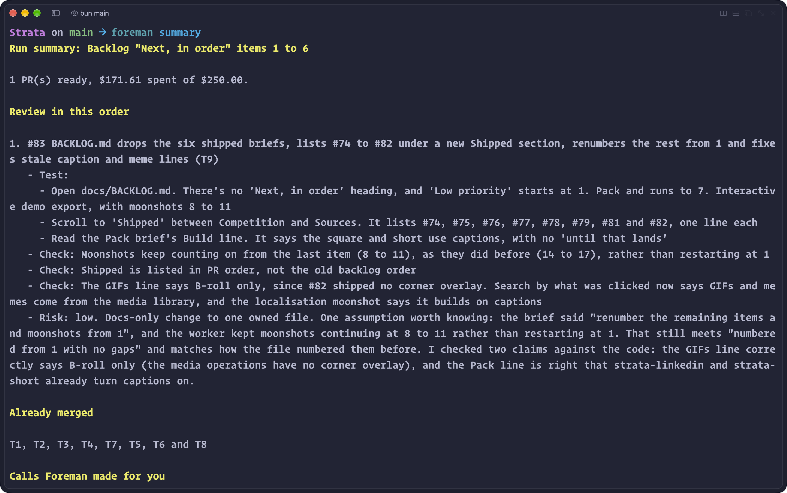

<p align="center">
    <picture>
        <source media="(prefers-color-scheme: dark)" srcset="assets/foreman-banner-dark.png">
        
    </picture>
</p>

## :firecracker: The problem

You've got a backlog and a deadline. One Claude Code session works through it one task at a time, and every task waits on you to review the last.

You could open five sessions yourself. Then you're the one splitting up the work, keeping sessions out of each other's way, checking every result and untangling the merge conflicts. You've become the bottleneck.

Foreman brings in a team, and a manager to run it. You set the direction and approve the PRs.

## :construction_worker: What is Foreman?

Foreman is a CLI and a Claude Code plugin. `foreman up` starts Claude Code with the plugin loaded, and that session runs the team:

- **The engineers** are worker sessions, numbered W1, W2 and so on. Each gets its own git worktree and tab, so they work in parallel without stepping on each other.
- **The manager** is the orchestrator. It never writes code. It plans, hands out work, keeps everyone aligned and checks the work before it reaches you.
- **The leader** is you. You set the direction and approve every PR.

### How it works

<p align="center">
    <picture>
        <source media="(prefers-color-scheme: dark)" srcset="assets/how-it-works-dark.svg">
        
    </picture>
</p>

1. **Give it a backlog.** Foreman talks it through with you, then turns each item into a brief with clear boundaries.
2. **It schedules the crew.** Foreman decides what runs in parallel and what goes first, based on dependencies and your deadline.
3. **Decisions are shared.** Workers propose decisions. Foreman accepts them and tells the crew, so conflicts surface before merge time.
4. **Work gets reviewed.** A separate reviewer checks each change against your intent, with screenshots for UI work, and sends it back until it's right.
5. **You approve the PR.** Each PR says what was asked, which decisions it touched, what changed on screen and how risky it is. Tasks that build on it start without waiting for the merge.

### What Foreman isn't

It's macOS and Claude Code only, and works on one repo at a time. Fewer moving parts means less to break.

### What it touches

- Workers run in Claude Code's auto mode, each in a worktree under `.foreman/worktrees/`, and commit to their own `foreman/<task>` branch
- The reviewer can only read files
- Foreman pushes each approved task's branch and opens its PR, plus a PR that adds accepted decisions to your ADR folder
- Foreman never merges unless you turn on [automerge](#let-foreman-merge), and then only its own task PRs
- It keeps its state in `.foreman/`, out of git, and picks up from there after a restart

### Why not Claude Code's agent teams?

Agent teams are great for research and review inside one session. Foreman is built for unattended builds that end in PRs, so it needs things teams don't offer:

- Each worker gets its own worktree, so workers never share a checkout
- Every task has its own budget, and a hung worker is spotted and restarted

## :sparkles: Features

- :camera: Takes before and after screenshots of web and macOS apps
- :books: Reads your repo's ADRs and keeps every worker to them
- :link: Tests the open PRs merged together, to catch ones that pass alone but break together
- :robot: Runs simple tasks on cheaper models
- :memo: Runs your tests on the base branch first, and warns every worker about what already fails
- :zzz: Keeps working while you're away, and logs every call it makes
- :iphone: Pings you on Telegram, and takes your answers from there
- :clipboard: Writes a summary of the PRs to review, in order

## :package: Install

Foreman runs on macOS inside a terminal app it can drive. [Rex](https://www.superlogical.com) is the default, and `FOREMAN_TERMINAL=<name>` picks another from `src/integrations/`. You need:

- Claude Code 2.1.224 or later
- [Bun](https://bun.sh), `git`, `fswatch` and `gh` (signed in with `gh auth login`), plus `jq` for Rex
- For web screenshots: Playwright's Chromium (`bunx playwright install chromium`)
- For macOS app screenshots: Xcode, and Screen Recording permission for your terminal in System Settings > Privacy & Security > Screen & System Audio Recording

```sh
brew install jq fswatch gh
git clone https://github.com/olimorris/foreman ~/Code/Foreman
cd ~/Code/Foreman && bun install
ln -s ~/Code/Foreman/bin/foreman ~/.local/bin/foreman
foreman doctor
```

### Working with an agent

Paste this to your coding agent, so it can answer questions about Foreman and help you set it up:

```text
Read https://raw.githubusercontent.com/olimorris/foreman/main/docs/agents.txt and help me with Foreman.
```

## :rocket: Usage

In your repo, start Foreman:

```sh
foreman up
```

Then tell it what you want done:

```text
Here's my backlog: BACKLOG.md. The deadline is tomorrow. Do it as cheaply as you can.
```

Foreman asks about anything unclear, then plans the work. If the plan differs from your backlog, such as splitting or cutting an item, it waits for your approval. If you don't answer within 30 minutes, Foreman makes the call and notes it in the summary. Workers open in their own tabs, and approved work arrives as PRs. `foreman help` lists every command.

### What each task is doing

```sh
foreman status
```


### What it's cost so far

```sh
foreman budget
```


By default, each task can spend $5 and the plan $40, which you can change in [Settings](#gear-settings). When a task goes over, Foreman stops its worker and asks whether to raise the limit.

On Pro, Max or another Claude subscription, these dollar amounts measure how much work was done at list prices, not what you pay. Your subscription's usage limit is what actually stops work. When a worker hits it, Foreman pauses every worker, starts nothing new and holds reviews until the limit resets, then picks each worker up where it left off. `foreman status` shows the wait and when the limit resets.

### When a permission blocks a session

Workers run in auto mode, so Claude Code sometimes refuses a call, such as `gh pr merge`, or waits at a permission prompt in a worker's tab. The same can happen to the reviewer and the orchestrator. The orchestrator tells you in one line, like:

> W2 on T5 was blocked from running `gh pr merge 41` by auto mode. To allow it, add `Bash(gh pr merge *)` in /permissions in that worker's tab, or tell me to skip it.

Meanwhile the worker carries on with anything that doesn't need that step, and `foreman status` and the status pane show the task under "Needs you". Once you allow it or say skip it, the orchestrator tells the worker and the task moves back. A worker waiting at a prompt is never treated as hung, and answering the prompt in its tab clears it.

### More or fewer workers

```sh
foreman workers 5
```

Runs up to 5 workers at once until the current plan finishes. The next plan goes back to `maxWorkers` from [Settings](#gear-settings). Lowering it never stops a running worker, and new tasks wait until fewer are running. After raising it, run `foreman next`, or ask the orchestrator, to start the tasks that were waiting. `foreman workers` on its own shows the limit and where it comes from.

### Let Foreman merge

```sh
foreman automerge on
```

Foreman merges each task's PR itself once the reviewer approves it and every check passes, until the current plan finishes. A PR with no checks merges once it's approved. When a check fails, Foreman doesn't merge and sends the worker to fix it. You can also tell the orchestrator "feel free to merge".

Foreman only merges its own task PRs, from `foreman/<task>` branches. Release PRs, the decisions PR and your own PRs stay with you. Your `never` list still applies. The reviewer won't approve a PR that a rule about merging covers, such as "Merge a PR that changes a migration", and switching automerge on lists those rules. A PR built on another task's branch waits until that task merges. Merges use squash when the repo allows it. `foreman automerge off` hands merging back to you, and `foreman status` shows when it's on.

### Pings on Telegram

Foreman can ping you on Telegram when something needs you, and you can answer from there. It goes through Claude Code's official Telegram plugin, so only the orchestrator talks to you. Set it up once:

1. Create a bot: message [@BotFather](https://t.me/BotFather) on Telegram, send `/newbot` and copy the token it gives you.
2. In any Claude Code session, run `/plugin install telegram@claude-plugins-official`, then `/telegram:configure <token>`.
3. Say when you want a ping in `.foreman/config.json`, in your own words:

   ```json
   { "telegram": { "when": "only when a question has waited 10 minutes, or the run is finished" } }
   ```

4. Run `foreman up`, then DM your bot. It replies with a pairing code. In the orchestrator's tab, run `/telegram:access pair <code>`. Pings start straight away, with no restart.
5. Run `foreman doctor` to check the plugin is installed and paired.

The orchestrator pings you when your words say to, in a line or two that names the task and worker. Anything you send the bot reaches the orchestrator as if you'd typed it in its tab. Workers and the reviewer never load the plugin, because each session that loads it takes the bot over. Messages you send only reach the orchestrator if your Claude Code account allows channels. Some Team and Enterprise organisations turn them off, and pings still go out.

### The PRs to review

```sh
foreman summary
```



What got done, the order to review the PRs in and how to test each one, what didn't get finished, and the calls Foreman made for you.

### How the run went

```sh
foreman timeline
```


When each task started, when its worker went quiet, and which tasks waited on it.

### Status pane

```sh
foreman pane
```


A status pane beside the orchestrator shows the run at a glance:

- **Needs you**: questions waiting on you, tasks that are blocked or stopped, and sessions a permission has blocked
- **Working**: what each worker is doing right now, and for how long
- **Ready to merge**: PRs waiting for you, with the reviewer's risk
- **Waiting**: planned tasks and what they wait on
- **Recent**: the last few things that happened

A worker that goes quiet turns yellow, then red.

## :gear: Settings

Settings live in `.foreman/config.json` in your repo, and every one is optional. Here they are with their defaults, or an example where there's no default:

```json
{
  "maxWorkers": 3,
  "budget": { "perTask": 5, "plan": 40, "tasks": { "T3": 15 } },
  "orchestratorModel": "opus",
  "workerModel": "sonnet",
  "reviewerModel": "opus",
  "stackTasks": true,
  "answerMinutes": 30,
  "stallMinutes": 20,
  "test": "bun install && bun test",
  "testMinutes": 15,
  "screenshots": { "adapter": "web", "start": "npm run dev -- --port {port}", "url": "http://localhost:{port}" },
  "prScreenshots": "local",
  "never": ["Merge a release PR. I cut every release."],
  "telegram": { "when": "only when a question has waited 10 minutes, or the run is finished" }
}
```

| Setting | What it does |
| --- | --- |
| `maxWorkers` | How many workers run at once. See [More or fewer workers](#more-or-fewer-workers) |
| `budget` | Spend limits in dollars: `perTask` for every task, `plan` for the whole plan and `tasks` for one task. `foreman budget` sets these for you |
| `orchestratorModel` | The model `foreman up` starts the orchestrator on, as an alias or a full model id. `foreman up --model <name>` overrides it for one run. Without it, the orchestrator uses Claude Code's default |
| `workerModel` | The model for tasks the plan doesn't give one, as an alias like `"sonnet"` or a full model id. Without it, workers use Claude Code's default |
| `reviewerModel` | The model the reviewer runs on. Without it, the reviewer uses Claude Code's default |
| `stackTasks` | `false` makes a task wait for its dependency to merge, instead of starting on top of its approved PR |
| `answerMinutes` | How long Foreman waits for your answer before it makes its own call. `0` makes it always wait |
| `stallMinutes` | How long a worker can go without replying, with no CPU use, before Foreman nudges it. It restarts the worker at twice this |
| `test` | The command that runs your tests in a fresh checkout, so include any setup. Foreman works it out if it's missing |
| `testMinutes` | How long one test run can take before Foreman stops it as hung |
| `screenshots` | How to run your app for before and after screenshots |
| `prScreenshots` | `"local"` lists screenshot paths in the PR. `"branch"` pushes them to a `foreman-screenshots` branch so they show on GitHub |
| `never` | Things Foreman must never do in this repo, one plain sentence each. The orchestrator sees the list when it starts, every brief lists it and the reviewer treats a change that breaks one as an issue |
| `telegram` | Turns on pings through Claude Code's Telegram plugin. `when` says in your own words when the orchestrator should ping you. See [Pings on Telegram](#pings-on-telegram) |

For a macOS app, `screenshots` builds the app instead of starting a server:

```json
{ "screenshots": { "adapter": "macos", "build": "xcodebuild -scheme App -derivedDataPath {derivedData} build", "app": "{derivedData}/Build/Products/Debug/App.app" } }
```

### Your own skills

Foreman can follow your own skills when it reviews work and opens PRs. Put each one in `.foreman/skills/<name>/SKILL.md`, in [Claude Code's skill format](https://code.claude.com/docs/en/skills): frontmatter with a `name` and a `description`, then the instructions. They stay on your machine, since Foreman keeps `.foreman/` out of git.

- The reviewer reads every skill and checks each change against the ones whose description fits reviewing code, like a code-review skill. Breaking one sends the change back to its worker, with the skill named.
- A skill named `pull-request` shapes the PRs Foreman opens. The reviewer writes the title and description by it, and Foreman adds the intent, assumptions, decisions, screenshots, verdict and risk below. A title that isn't a conventional commit is dropped for the task's own title.
- A skill named `adr` shapes the decisions Foreman records. The orchestrator writes each one in its format, and in a repo with no ADR folder yet, the new folder takes the skill's title line, status and a README that describes them. An existing ADR folder keeps its own convention.
- Workers don't see these skills, so they shape the review and the PR, not how workers build.

Foreman names each skill by its folder, so a skill copied in as `.foreman/skills/adr/` is the `adr` skill whatever its frontmatter says. Foreman's own [pull-request skill](.claude/skills/pull-request/SKILL.md) is a working example. Copy it in and make it yours:

```sh
mkdir -p .foreman/skills && cp -r ~/Code/Foreman/.claude/skills/pull-request .foreman/skills/
```

Skills apply from the next review, so add them before a task reports done. Without `.foreman/skills/`, the review and the PR stay as they are.
